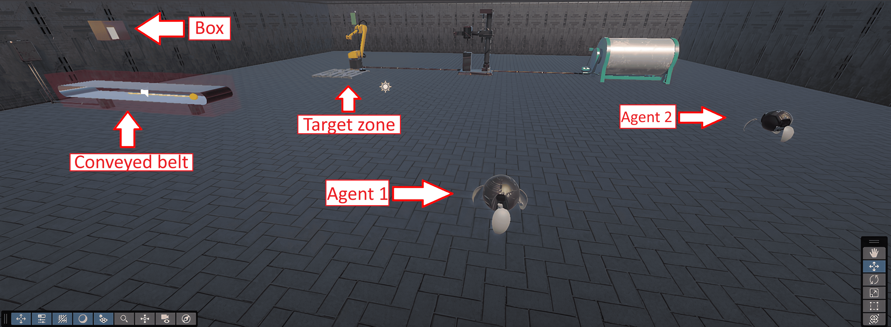
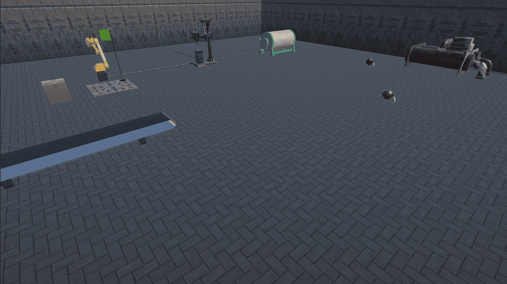
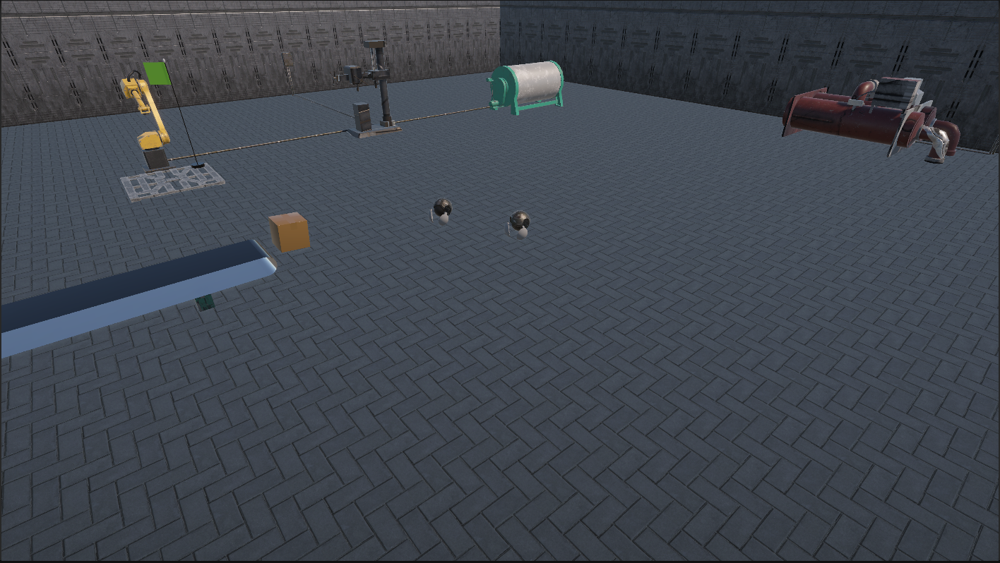
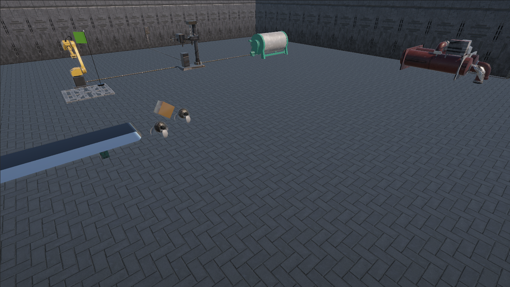
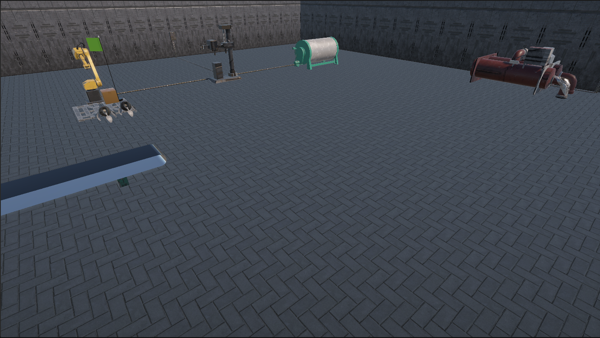
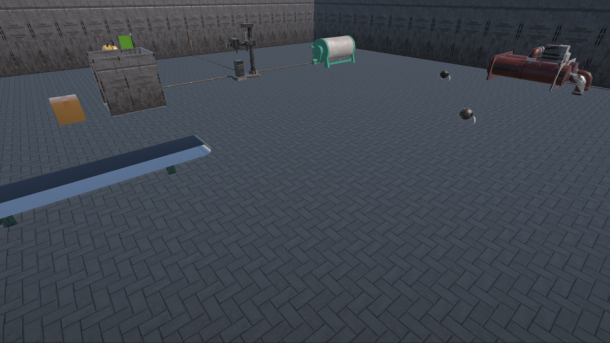
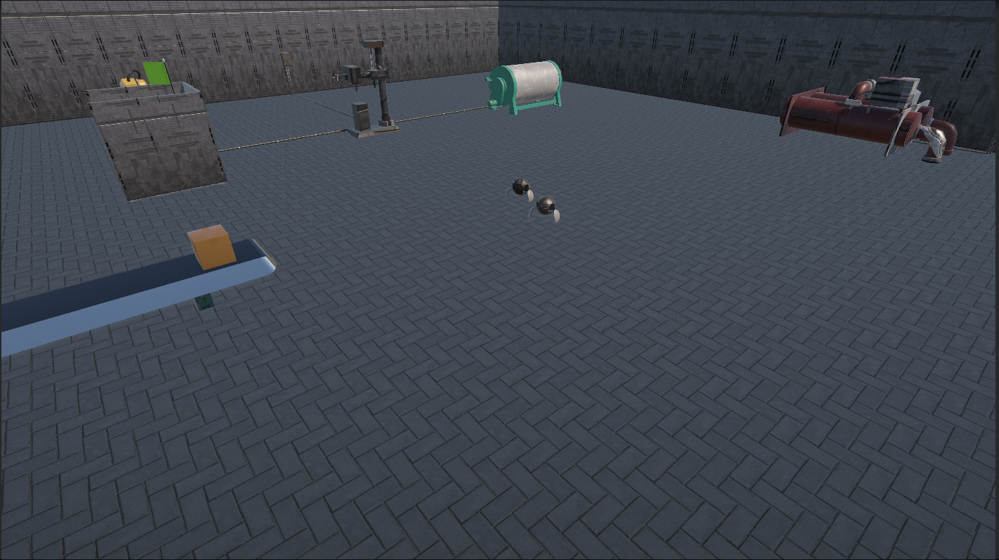
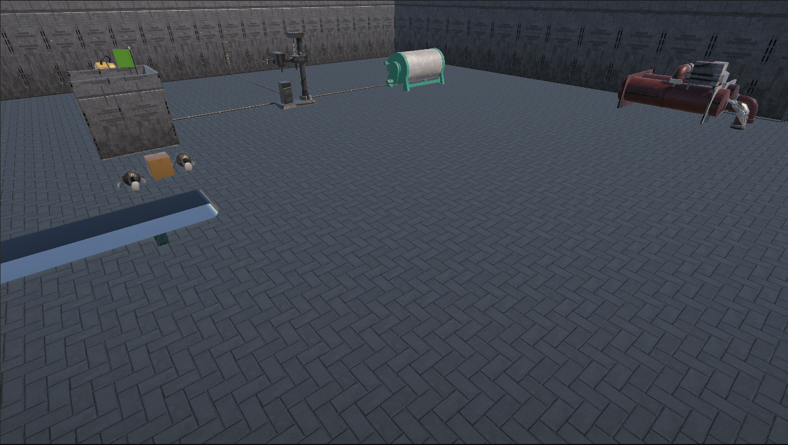
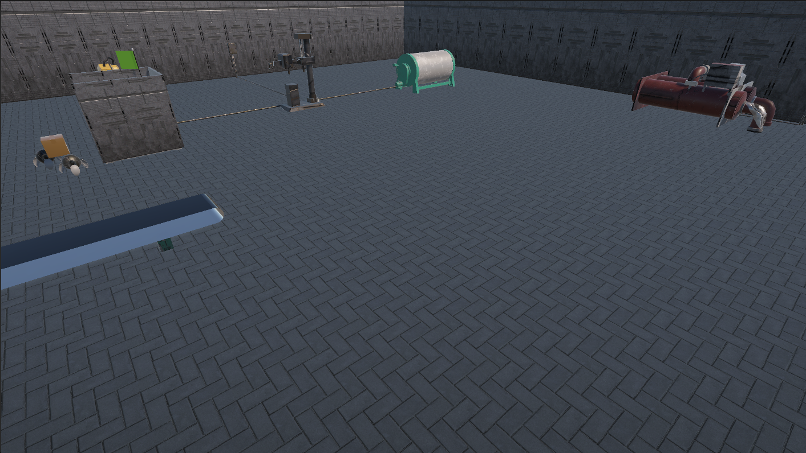

# Multi-Agent Reinforcement Learning for Collaborative Object Manipulation

 *(Under Review - Manuscript ID 10973)*

This repository contains the Unity ML-Agents environment, source code, hyperparameter configurations, and standalone executables for our research on collaborative object manipulation using Multi-Agent Reinforcement Learning (MARL).

  

## Overview
In modern flexible manufacturing systems, autonomous robots must learn collaborative behaviors without constant reprogramming. This project simulates a cooperative task where two agents must transport a shared object to a designated delivery zone. We evaluate three decentralized algorithms: **PPO, SAC, and MA-POCA**.

The project evaluates the agents in two distinct scenarios:

### 1. Base Environment (Obstacle-Free)
Designed to evaluate pure coordination and basic collaborative transport.

  

  <em>Learned trajectory sequence:</em> 
    

### 2. Complex Environment (With Obstacles)
Transportation requires spatial awareness and synchronized maneuvering to avoid the central obstacle before reaching the target.

  

  <em>Learned trajectory sequence avoiding the obstacle:</em> 
    

---

## Repository Structure
* `Assets/`: Unity source code, C# agent scripts, 3D models, and scene files.
* `Packages/`: ML-Agents dependencies (`manifest.json`).
* `Config_yaml/`: Training hyperparameter configurations (`configPOCA.yaml`, `configPPO.yaml`, `configSAC.yaml`).
* `Resources/`: Contains the pre-compiled Windows standalone builds compressed as `.zip` files (`Ejecutable_simple.zip` and `Ejecutable_complejo.zip`).
* `images/`: Visual assets showing environment layouts and learned trajectories.

## Running the Pre-compiled Environments
You do not need to install Unity to test the behaviors. Simply navigate to the `Resources/` folder, extract the desired archive (`Ejecutable_simple.zip` or `Ejecutable_complejo.zip`), and run the `.exe` file located inside the extracted folder to observe the agents performing the task.

## Running from Source (Unity)
To open the project and train the models yourself, ensure you are using a compatible Unity version (e.g., Unity 2022.3) and the corresponding ML-Agents Release package. 

### Training Configurations
The `Config_yaml` folder contains the exact hyperparameters used to train the agents in our research. You can start training by running the ML-Agents CLI with the desired config file. For example:

`mlagents-learn Config_yaml/configSAC.yaml --run-id=SAC_Run1`

### Agent Scripts and Architecture
Due to the architectural differences in how ML-Agents handles individual versus group rewards, we provide two separate agent scripts to reproduce the experiments:

1. **For PPO and SAC (Independent architectures):** Assign the `AgenteColaborador_PPO_SAC.cs` script to the agents. This utilizes individual credit assignment (`AddReward`).
2. **For MA-POCA (Centralized architecture):** Assign the `AgenteColaborador.cs` script. This requires the `SimpleMultiAgentGroup` component and utilizes group credit assignment (`AddGroupReward`).

**Note on Reward Visualization (MA-POCA):** 
In the raw training data, MA-POCA agents accumulated a slightly higher maximum reward (~200) compared to PPO/SAC (~150) due to how group rewards are summed, despite all algorithms achieving the exact same collaborative success. To allow for a fair visual comparison in the manuscript's learning curves, MA-POCA rewards were scaled to match the ~150 baseline. For full transparency, the provided `AgenteColaborador.cs` script includes a `factorNormalizacion = 0.75f` variable. This linear scaling affects only the visualization limits in TensorBoard and does not alter the underlying policy optimization.